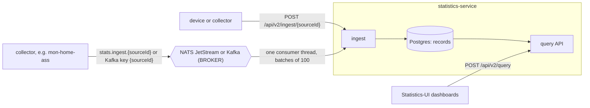

# StatisticsService

Backend of the universal statistics platform (spec
[004](specs/004-universal-stats-platform/spec.md)): sources push data, mappings
turn it into records of a dataset, dashboards query them. Everything domain
specific is configuration (JSON definitions), not code. Frontend: the
`Statistics-UI` repo.

## How data gets in

The service never fetches data. Devices and collectors send it, either over HTTP
or through a broker, and every payload goes the same way into Postgres:



What happens to one payload (`IngestService`):

1. **Source**: looked up by id; unknown id → 404.
2. **Token**: `Authorization: Bearer <source token>` must match the source credential → else 401.
3. **Channel**: a `push` source takes HTTP only, a `pubsub` source the broker only → else 409. A paused source → 503.
4. **Mapping**: the source mapping turns the payload into records of its dataset (timestamp, `dims`, `vals`).
   Any invalid field → 400 with one reason per problem and nothing stored; the reasons also land in
   `GET /api/v2/sources/{sourceId}/status`.
5. **Duplicates**: records with the same `identity` as stored ones are counted as duplicates and skipped.
6. **Store**: the records go into the `records` table. Dashboards read them through the query API, which
   aggregates in Postgres (`date_bin` buckets, `GROUP BY`); there is no cache in between.

Over a broker there is no HTTP answer: a message is acked only after step 6. Rejected messages (steps 1 to 4)
are acked and counted, and all but an unknown source show up in the source status. Database errors are retried
with back-off.

| To read | Where |
| --- | --- |
| Push from a device (payload, responses) | [.docs/Device_Ingest.md](.docs/Device_Ingest.md) |
| Writing a collector, publishing to a broker | [.docs/Collector_Apps.md](.docs/Collector_Apps.md) |
| Broker settings (`BROKER`, `KAFKA_*`, `NATS_*`) | [Pub/sub ingestion](#pubsub-ingestion-kafka--nats-jetstream) below |
| Definition format (datasets, sources, mappings, dashboards) | [contracts/definition-format.md](specs/004-universal-stats-platform/contracts/definition-format.md) |
| Full API | [contracts/api-v2.md](specs/004-universal-stats-platform/contracts/api-v2.md) |
| Example definitions | [definitions/](definitions/): `temperature` (push), `epidemic` (push, `each`), `home-assistant` (pubsub, fed by mon-home-ass) |

## Run locally

The compose file starts PostgreSQL 16 with database, user and password `stats`:

```bash
docker compose -f .devops/postgres-compose/compose.yaml up -d
./gradlew runLocal
```

`runLocal` is the local profile: it starts the app with
`-config=application.yaml -config=.devops/application-local.yaml` (Ktor merges the files, the later one wins)
and `LOG_FORMAT=plain`. [.devops/application-local.yaml](.devops/application-local.yaml) turns on password
sign-in only (no OIDC), points at the compose database, allows the web dev server
(`localhost:8081`, `127.0.0.1:8081`), keeps `TRUST_PROXY` off and creates the dev admin `admin@local` /
`change-me-now` (only while there are no users). The file is outside `src/main/resources`, so the image
never contains it. Stop with Ctrl+C, then `docker compose -f .devops/postgres-compose/compose.yaml stop`.
Web UI: `Statistics-UI` README, "Run locally".

## Configuration

`./gradlew run` and the image read the environment:

| Env | Default | Meaning |
|-----|---------|---------|
| `DB_URL`, `DB_USER`, `DB_PASSWORD` | `jdbc:postgresql://localhost:5432/stats`, `stats`, `stats` | database; the schema is created on start |
| `ADMIN_EMAIL`, `ADMIN_PASSWORD` | empty | first admin, created only while there are no users; see sign-in methods |
| `CORS_HOSTS` | `localhost:8081` | comma-separated frontend hosts |
| `TRUST_PROXY` | `false` | `true` behind a reverse proxy (e.g. the Istio gateway): the login rate limit keys on the last `X-Forwarded-For` entry; keep `false` without one, clients could spoof it |
| `LOG_FORMAT` | `json` | `plain` for human-readable local logs |

API: `http://localhost:8080/api/v2`, Swagger UI at `/api/v2/swagger`.

## Sign-in methods / OIDC

Users sign in with a password, through one OpenID Connect provider, or both.
Either way they get the same session token; roles stay managed in the app, and
devices keep using source tokens.

| Env | Default | Meaning |
|-----|---------|---------|
| `AUTH_LOCAL` | `true` | password sign-in; `false` = provider only (start fails without a provider) |
| `OIDC_ISSUER` | empty | provider issuer URL, e.g. `https://auth.example.com:9091`; provider on when issuer and client id are set |
| `OIDC_CLIENT_ID` | empty | client registered at the provider |
| `OIDC_CLIENT_SECRET` | empty | only for confidential clients (sent as HTTP Basic) |
| `OIDC_NAME` | `SSO` | button label: "Sign in with …" |

- Register the client with PKCE (S256) and the redirect URIs of the frontends:
  the web UI's origin + `/` (dev: `http://localhost:8081/`) and
  `http://127.0.0.1/callback` for the desktop app (any port).
- First provider sign-in creates a viewer. An existing account with the same
  email is linked only if the provider marks the email verified.
- `ADMIN_EMAIL` without `ADMIN_PASSWORD`: no local admin; the first sign-in
  through the provider with that (verified) email becomes admin.
- A self-signed provider certificate needs a JVM truststore
  (`-Djavax.net.ssl.trustStore=…`).
- Dev provider: [.devops/authelia-compose/README.md](.devops/authelia-compose/README.md).

## Load the example definitions

```bash
API=http://localhost:8080/api/v2
TOKEN=$(curl -s $API/auth/login -H 'Content-Type: application/json' \
  -d '{"email":"admin@local","password":"change-me-now"}' | jq -r .token)
for f in definitions/*.json; do
  curl -s -X POST $API/import -H "Authorization: Bearer $TOKEN" -H 'Content-Type: application/json' -d @$f; echo
done
curl -s -X POST $API/sources/temperature/credential -H "Authorization: Bearer $TOKEN"
```

The last call prints the source token the device sends. Devices and collector apps: [.docs/Device_Ingest.md](.docs/Device_Ingest.md),
[.docs/Collector_Apps.md](.docs/Collector_Apps.md).

## Pub/sub ingestion (Kafka / NATS JetStream)

Besides HTTP push, sources with `"channel": {"type": "pubsub"}` take messages
from one broker chosen by `BROKER`; switching the broker changes no definition.
Message contract: [api-v2.md, Pub/sub](specs/004-universal-stats-platform/contracts/api-v2.md#pubsub);
for collectors: [.docs/Collector_Apps.md](.docs/Collector_Apps.md).

| Env | Default | Meaning |
|-----|---------|---------|
| `BROKER` | `none` | `none`, `kafka` or `jetstream`; anything else stops the start |
| `KAFKA_BOOTSTRAP_SERVERS` | empty | required with `kafka`, e.g. `kafka:9092` |
| `KAFKA_TOPIC` | `stats.ingest` | the one topic; record key = source id |
| `KAFKA_GROUP_ID` | `statistics-service` | consumer group (starts at the earliest offset) |
| `KAFKA_SECURITY_PROTOCOL` | `PLAINTEXT` | or `SSL`, `SASL_PLAINTEXT`, `SASL_SSL` |
| `KAFKA_SASL_MECHANISM` | `PLAIN` | `PLAIN`, `SCRAM-SHA-256` or `SCRAM-SHA-512`, used with `SASL_*` |
| `KAFKA_USER`, `KAFKA_PASSWORD` | empty | required with `SASL_*`, not allowed without |
| `NATS_URL` | empty | required with `jetstream`, `nats://…` or `tls://…` |
| `NATS_STREAM` | `STATS_INGEST` | created or updated on every start: subjects `<prefix>.>`, file storage |
| `NATS_SUBJECT_PREFIX` | `stats.ingest` | subject = `<prefix>.<sourceId>` |
| `NATS_DURABLE` | `statistics-service` | durable pull consumer, explicit ack |
| `NATS_STREAM_MAX_AGE`, `NATS_STREAM_MAX_BYTES` | `7d`, `268435456` | stream limits; the oldest messages go first |
| `NATS_USER` + `NATS_PASSWORD`, or `NATS_TOKEN` | empty | broker credentials |

- At least once: a message is acked (JetStream) or committed (Kafka) only after
  its records are stored. Messages that can never be stored (bad token, unknown
  or `push` source, paused source, mapping errors) are acked, counted and shown
  in the source status; database failures are retried with back-off (1 s → 30 s).
- The consumer starts with the app, keeps retrying while the broker is down and
  never affects `/health/ready`. `/metrics`: `statistics_broker_consuming`,
  `statistics_broker_pending_messages`,
  `statistics_broker_messages_total{outcome="stored|rejected|retried"}`.
- HTTP push to a `pubsub` source answers 409.
- A `pubsub` source needs a mapping with an `identity` in every rule (400
  otherwise), so redelivered messages are not stored twice.

Locally (with Postgres already up as above), pick one broker. Kafka: the
compose file runs apache/kafka 4.4.0 in KRaft mode on `localhost:9092`:

```bash
docker compose -f .devops/kafka-compose/compose.yaml up -d
BROKER=kafka KAFKA_BOOTSTRAP_SERVERS=localhost:9092 ./gradlew runLocal
```

NATS: the compose file runs nats 2.15.2 with JetStream on `localhost:4222`:

```bash
docker compose -f .devops/nats-compose/compose.yaml up -d
BROKER=jetstream NATS_URL=nats://localhost:4222 ./gradlew runLocal
```

With the example definitions loaded (`API`, `TOKEN` as above), switch
`temperature` to pub/sub and build one reading:

```bash
curl -s $API/sources/temperature -H "Authorization: Bearer $TOKEN" | jq '.channel.type = "pubsub"' |
  curl -s -X PUT $API/sources/temperature -H "Authorization: Bearer $TOKEN" -H 'Content-Type: application/json' -d @-
SOURCE_TOKEN=$(curl -s -X POST $API/sources/temperature/credential -H "Authorization: Bearer $TOKEN" | jq -r .token)
PAYLOAD="{\"deviceId\":\"pico-1\",\"timestamp\":\"$(date -u +%FT%TZ)\",\"temperature\":21.5,\"humidity\":40}"
```

Then send it with the command matching `BROKER`.

Kafka: the record key is the source id and the `Authorization` header carries
the source token (the console producer reads headers, key and value separated
by tabs):

```bash
printf 'Authorization:Bearer %s\ttemperature\t%s\n' "$SOURCE_TOKEN" "$PAYLOAD" |
  docker compose -f .devops/kafka-compose/compose.yaml exec -T kafka /opt/kafka/bin/kafka-console-producer.sh \
    --bootstrap-server localhost:9092 --topic stats.ingest --reader-property parse.key=true --reader-property parse.headers=true
```

NATS: the subject is `stats.ingest.<source id>` and the `Authorization` header
carries the source token:

```bash
docker run --rm --network host natsio/nats-box:0.20.1 \
  nats pub -s nats://localhost:4222 stats.ingest.temperature "$PAYLOAD" -H "Authorization:Bearer $SOURCE_TOKEN"
```

Check the source status; it should show `accepted.hour = 1`:

```bash
curl -s $API/sources/temperature/status -H "Authorization: Bearer $TOKEN"
```

Stop with `docker compose -f .devops/<kafka|nats>-compose/compose.yaml down` (broker data is not kept).

## Kubernetes (homelab platform)

Deployed per the homelab platform contract (kept with the cluster, outside this repo).
[.devops/helm/](.devops/helm/) (Flux HelmRelease of
the platform's shared chart `charts/app`, namespace `apps`) is read directly
by Flux from `main` of this repo (registered on the cluster side); CI rewrites the `image:` tag in
`release.yaml` on every push to `main`.

- Image: `ghcr.io/jagieloadrian/statistics-service`, built by Jib
  (linux/amd64 + linux/arm64, eclipse-temurin:21-jre, user 10001). CI pushes
  `main-<yyyyMMddHHmmss>-<sha7>` from `main` and the semver version from `v*`
  tags, never `latest`; only `main` builds are deployed automatically.
- Route: HTTPRoute on `home-gateway`, host `statistics.home.arpa`, path
  `/api/`; everything else belongs to `statistics-ui` (same origin).
- Callers: `home-gateway` only (AuthorizationPolicy admits
  `istio-ingress/home-gateway-istio`). Callees: Postgres (platform-managed),
  the OIDC provider and, when `BROKER` is not `none`, the broker:
  NATS `nats.apps.svc.cluster.local:4222` (user `statistics-service`: `$JS.API.>`,
  `$JS.ACK.>`, subscribe `stats.ingest.>` and `_INBOX.>`) or Kafka. Collectors
  publish to the broker, not to this service.
- Backup: the service is stateless; the database is backed up by the platform.
- One replica: login rate limits and source status are kept in memory.

Environment comes from a ConfigMap (Helm values, a change rolls the Deployment)
and a Secret synced from Vault:

- `values.env` in [release.yaml](.devops/helm/release.yaml), plain → ConfigMap
  `statistics-service-config`: `DB_URL`, `DB_USER`, `ADMIN_EMAIL`,
  `AUTH_LOCAL`, `OIDC_ISSUER`, `OIDC_CLIENT_ID`, `OIDC_NAME`, `CORS_HOSTS`,
  `TRUST_PROXY`, `LOG_FORMAT`, `BROKER` (`jetstream`), `KAFKA_*` (no password) and
  `NATS_*` (no password/token; `NATS_URL` points at the in-cluster NATS).
  `NATS_PASSWORD` comes from the secret.
- Vault `secret/apps/statistics-service` (keys = env names, set with
  `vault kv put`) → ExternalSecret from the chart
  (`secrets: true` in `release.yaml`) → Secret `statistics-service-secrets`:
  `DB_PASSWORD`, `ADMIN_PASSWORD`, `OIDC_CLIENT_SECRET`, and with a broker
  `NATS_PASSWORD` (or `NATS_TOKEN`) or `KAFKA_PASSWORD`. Nothing secret in git,
  CI needs no keys; after a change `kubectl -n apps rollout restart deploy/statistics-service`.

- Database: role and schema `statistics` in database `statistics` on the
  Postgres running on the Wyse host, reached as
  `postgres.apps.svc.cluster.local:5432`.
- Deploy: a push to `main` builds the image and CI commits the new tag to
  `.devops/helm/release.yaml`; Flux reads that directory and rolls it out. `main` is protected, so the CI step "Deploy (bump image tag)" pushes as a
  GitHub App on the ruleset bypass list (variable `DEPLOY_APP_CLIENT_ID`,
  secret `DEPLOY_APP_PRIVATE_KEY`). The tag commit carries `[skip ci]`.
- `install.remediation.retries: -1` in `release.yaml`: Flux keeps retrying the
  first install (e.g. until the Vault secrets exist), no manual
  `flux reconcile --force`; a failed upgrade is retried 3 times.

- OIDC redirect URI for the web UI: `http://statistics.home.arpa/`. The
  gateway serves plain HTTP, so the provider must accept an `http` redirect
  URI for this host.
- `TRUST_PROXY=true`: the login rate limit keys on the client IP the gateway
  appends to `X-Forwarded-For`.

### Operations

| Endpoint / env | Meaning |
|----------------|---------|
| `GET /health/live` | 200 while the process runs; touches no dependency |
| `GET /health/ready` | 200 when the database answers, 503 otherwise; the broker is never checked |
| `GET /metrics` | Prometheus metrics (not under `/api/`, so not routed by the gateway), incl. `statistics_broker_*` |
| `LOG_FORMAT` | `json` (default): one JSON object per line with `timestamp`, `level`, `message`, `logger`, `traceId`; `plain` for local reading |

- SIGTERM: waits up to 8 s for in-flight calls, closes Netty (`shutdownTimeout`
  2 s), gives the broker consumer 3 s to finish its message and ack/commit,
  then closes the database pool and exits 0: at most ~17 s, measured 12.1 s
  with a query and a broker message both blocked on a table lock (unfinished
  messages are redelivered). `preStop` sleeps 3 s, `terminationGracePeriodSeconds` is 30.
- Outbound OIDC calls: connect timeout 2 s, request timeout 10 s, W3C
  `traceparent` propagated; `traceId` comes from the incoming `traceparent`.
- Postgres (pgjdbc): connect timeout 2 s, socket timeout 60 s, so a dead
  database connection frees its thread instead of hanging.
- Invalid configuration (e.g. `DB_URL` not `jdbc:postgresql://`, `AUTH_LOCAL`
  not a boolean, only one of `OIDC_ISSUER`/`OIDC_CLIENT_ID`) logs one JSON
  error line and exits 1.

### Definition of Ready

Verified in this repo and its image:

- [x] Multi-arch image via Jib, non-root 10001, no secrets in image — verified
  with `docker buildx imagetools inspect` and a local registry
- [x] Probes, `/metrics`, JSON logs, SIGTERM exit 0 with drain — verified
  against the image (read-only root filesystem, 384 Mi limit)
- [x] Readiness 503 while Postgres is down, 200 after it returns — verified
- [x] Fail-fast config, single JSON error line, exit 1 — verified
- [x] `kubeconform -strict` of `.devops/helm` incl. Flux CRDs (CI `devops.yml`); chart output (`helm template`
  + kubeconform incl. HTTPRoute, AuthorizationPolicy) and `istioctl validate` (1.30) — verified by hand
- [x] CI workflow — `actionlint` clean
- [x] `DB_URL` points at the platform Postgres (`postgres.apps.svc.cluster.local`)
- [x] Registered in the cluster's Flux
- [x] Pub/sub: `BROKER: jetstream` in `values.env` (`release.yaml`); the platform's NATS AuthorizationPolicy
  admits `cluster.local/ns/apps/sa/statistics-service`

On deploy, done by hand on the homelab (steps of the platform setup guide):

| What | Where |
| --- | --- |
| Role + schema `statistics` on the Wyse Postgres | step 2 |
| Secrets in Vault `secret/apps/statistics-service`, incl. `NATS_PASSWORD` (not digits-only) | step 4 (`scripts/install.sh` asks for them) |
| OIDC client with redirect URI `http://statistics.home.arpa/` (only with SSO) | step 1, `OIDC_*` rows |

## Build & test

`./gradlew check` runs ktlint and all tests (warnings are errors); tests start
PostgreSQL, Kafka and NATS through Testcontainers, so Docker must be running.
`./gradlew jibDockerBuild` builds the image into the local Docker daemon.

## Docs

- Spec, plan, contracts: [specs/004-universal-stats-platform/](specs/004-universal-stats-platform/)
- API contract: [contracts/api-v2.md](specs/004-universal-stats-platform/contracts/api-v2.md)
- Definition format: [contracts/definition-format.md](specs/004-universal-stats-platform/contracts/definition-format.md)
